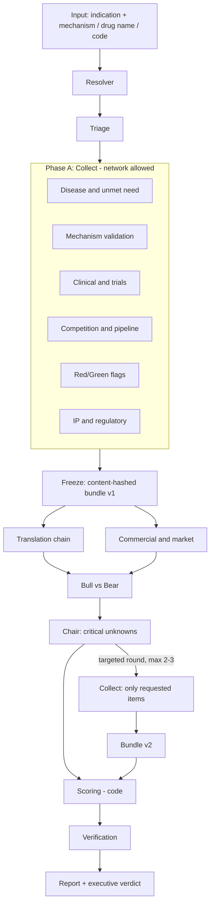

# Architecture

## 1. Goals and non-goals

**Goals**

- Produce a defensible Invest / Conditional / Do Not Invest verdict for any indication x mechanism pair.
- Every conclusion traceable to a quote in a source that was fetched in the same run.
- Say "unknown" with a reason, and turn it into a diligence question.
- Recompute the verdict when new evidence arrives, and show what changed.
- Finish a full run in a live-demo time budget (target 5-7 minutes, TODO confirm with organizers).

**Non-goals**

- Beating curated commercial databases on data coverage.
- Predicting approval with a trained model.
- Free-form web research by autonomous agents.

## 2. Overview

The outer structure is a deterministic DAG (LangGraph). Inside each node a small tool-calling agent has a step limit. LangGraph is used only as a DAG runner with checkpointing. Tracing and cost accounting are our own code so nothing is hidden. See ADR-001.

## 3. Two phases per run

| Phase | Network | Output |
|---|---|---|
| **Collect** | allowed, through connectors only | raw documents with URL, date, locator, fetched into the evidence store |
| **Freeze** | none | immutable bundle with a content hash, a source catalog (allowlist) and `as_of` |
| **Reason** | **forbidden** | claims, each pointing to evidence in the bundle |

Rule: *absence from the bundle means unknown, not false.* The reasoning code does not import any HTTP client, which is enforced by a test.

A targeted second round (from Chair) runs Collect only for the requested items, creating bundle v2. Reasoning then re-runs against v2.

## 4. Stages

1. **Resolver.** Normalizes input to indication IDs (MONDO/EFO), targets (UniProt/Ensembl), action, modality, delivery, tissue and known assets. Fields it infers itself are listed in `assumptions`. Accepts a drug name or code, for example a company code in brackets, and resolves it through ChEMBL and Open Targets. Names that look similar are disambiguated by ID, never by string match.
2. **Triage (1-2 min).** Basic facts, red flags, whether any human evidence exists. Decides which sections need depth and which can stay shallow, which controls cost.
3. **Stage 1, parallel.** Disease and unmet need; mechanism validation; clinical/trials; competition and pipeline; red/green flags; IP and regulatory.
4. **Stage 2, parallel, depends on stage 1.** Translation chain (needs mechanism and clinical); commercial and market (needs disease and competition).
5. **Bull vs Bear.** Two reasoning steps build the strongest case for and against, over the same frozen bundle. Bear looks specifically for contradicting evidence and failed analogs.
6. **Chair.** Lists critical unknowns. Triggers up to 2-3 targeted rounds. What stays unanswered becomes a diligence question.
7. **Scoring (code).** Gates, confidence, probability of success, rNPV, capital, verdict. See [`scoring.md`](scoring.md).
8. **Verification.** Grounding and entailment checks before the report is released.

## 5. Agent contract

Each agent is a node with a declared contract.

| Field | Example |
|---|---|
| `name` | `competition` |
| `depends_on` | `["resolver"]` |
| `tools` | `ctgov_search`, `openfda_labels`, `opentargets_drugs` |
| `model` | cheaper model for collection, stronger for Bear and Chair |
| `max_steps` | 8 tool calls |
| `timeout_s` | 90, after which the section is marked `incomplete` |
| `output_schema` | `{ evidence: [...], claims: [...], unknowns: [...] }` |

Per-node timeouts and error handlers are available in LangGraph 1.2 (see [`stack.md`](stack.md)); use them to implement `timeout_s` and the `incomplete` status.

Collect agents write **evidence**. Reason steps write **claims**. Neither writes URLs or IDs itself: connectors return them.

## 6. Evidence store and versions

- Evidence is append-only. A new document creates a new store `version`.
- Every query can pass `as_of`. Connectors and the store filter by publication date, so a run can be replayed as of an earlier date.
- Source-family order and conflict rules are in [`sources.md`](sources.md).
- Schema: [`data-model.md`](data-model.md).

## 7. Verification gates

| # | Check | Question | Method |
|---|---|---|---|
| 1 | Source validity | Was this URL or ID fetched in this run? | exact match against the bundle catalog |
| 2 | Evidence presence | Is the quote in the bundle, and the number in the quote? | string check (code) |
| 3 | Claim entailment | Does the quote actually support the claim? | LLM judge from a different provider, scored against a manual sample |
| 4 | Source authority | Is this the right source family for this field? | rule table |
| 5 | Temporal validity | Is this the current figure or an older cutoff? | date and conflict rules |

A claim failing 1 or 2 is dropped. A claim failing 3 is downgraded to `hypothesis`. Failures are logged.

## 8. Incremental re-underwrite

When evidence is added (live input, time-travel, or injected test document):

1. Store it as a new version.
2. Classify it: level, stance, affected claims (LLM classifies, code validates references).
3. Recompute confidence of the affected claims.
4. Re-check gates; recompute PoS, rNPV and capital.
5. Emit the new verdict and a diff: changed claims, changed translation-chain links, PoS and rNPV deltas, and which evidence moved which claim through which gate.

A single weak result (for example one in vitro experiment) must not override strong human evidence. A strong counter-result changes the verdict. Both cases are part of the demo and the tests.

## 9. LLM layer

One function, `llm.call(step, prompt, schema)`, that:

- reads model, effort and temperature per step from config;
- validates output against a Pydantic schema and retries on invalid JSON;
- caches by hash of (model, parameters, prompt);
- fails over by error class (rate limit, quota, 5xx, timeout; never on auth errors);
- logs model, tokens, cost, latency, attempts and the real executing model;
- enforces the per-run budget cap.

Details and prices: [`cost.md`](cost.md), ADR-004.

## 10. Failure handling

| Failure | Behavior |
|---|---|
| A source is down | Section status `error`, with the source named. Report still generated. |
| An agent times out | Section marked `incomplete`; run continues. |
| LLM rate limit or quota | Retry, then failover; run is flagged `mixed_models` in the trace. |
| Budget cap reached | Remaining steps use cheaper settings or are skipped and marked. |
| Verification drops a claim | Logged; the section shows the gap rather than a softened claim. |

Section statuses: `found`, `conflicting`, `not_reported`, `none_found`, `not_searched`, `error`, `incomplete`.

## 11. Observability

Every run has a `run_id`. The trace records each step, tool call, LLM call (model, tokens, cost, latency), cache hits, verification outcomes and the bundle hash. The UI shows a trace panel with total tokens and cost.

## 12. API

Implemented in `bioverdict/api/` (response shapes in `api/schemas.py`). Runs are answered from
fixtures while `USE_FIXTURES=1` (the default until the live pipeline is wired in); the routes and
shapes do not change when that is replaced. Interactive documentation: `/docs` on a running server.

| Method and path | Purpose | State |
|---|---|---|
| `POST /runs` | Start a run: `{ asset, as_of? }`, returns `run_id` at once (202). Fixture mode knows the assets listed in `fixtures/`; others get 422 with the list | done |
| `GET /runs`, `GET /runs/{id}` | List runs, one run's status and verdict | done |
| `GET /runs/{id}/events` | SSE progress: one event per step and status, then `end`; resumes from `Last-Event-ID` | done |
| `GET /runs/{id}/report` | `ReportResponse`: executive verdict, sections with claims and links, translation chain, gates, diligence questions, assumptions, cited sources, bundle identity. 409 while the run is going | done |
| `GET /runs/{id}/claims/{claim_id}` | One claim with its links | done |
| `GET /runs/{id}/evidence/{evidence_id}` | One evidence item with excerpt, source and the claims that quote it | done |
| `GET /runs/{id}/trace` | Steps, model calls, tokens and cost | done |
| `POST /runs/{id}/evidence` | Add evidence (URL or text); creates a new version and returns the diff | A7 |
| `GET /runs/{id}/diff?from=v1&to=v2` | Before/after | A7 |

Every claim and evidence item carries a badge: `source_fact` (copied from a source),
`ai_inference` (a model's judgement) or `unknown` (a gap, with the kind of data that would answer it).

## 13. Security

Keys in `.env`. Only public data is sent to providers. Note that the free tier of some providers may use submitted content to improve their products; that is acceptable only because inputs are public documents.

## 14. Open questions

- Final query format and time limit at the finals (ask organizers).
- Thresholds for the verdict mapping (calibrated on the eval set).
- Whether AACT is needed beyond `why_stopped` and aggregates.
