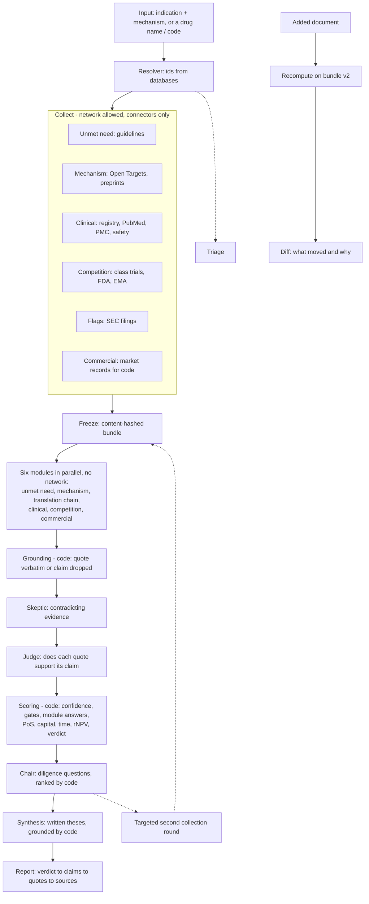

# Architecture

## 1. Goals and non-goals

**Goals**

- Produce a defensible Invest / Conditional / Do Not Invest verdict for any indication x mechanism pair.
- Every conclusion traceable to a quote in a source that was fetched in the same run.
- Say "unknown" with a reason, and turn it into a diligence question.
- Recompute the verdict when new evidence arrives, and show what changed.
- Finish a full run in a live-demo time budget (target 5-7 minutes, TODO confirm with organizers).

**Non-goals**

- Beating curated commercial databases on data coverage.
- Predicting approval with a trained model.
- Free-form web research by autonomous agents.

## 2. Overview

As built (2026-10-10). Dashed: designed, not built.

The outer structure is a deterministic DAG (LangGraph). Inside each node a small tool-calling agent has a step limit. LangGraph is used only as a DAG runner with checkpointing. Tracing and cost accounting are our own code so nothing is hidden. See ADR-001.

## 3. Two phases per run

| Phase | Network | Output |
|---|---|---|
| **Collect** | allowed, through connectors only | raw documents with URL, date, locator, fetched into the evidence store |
| **Freeze** | none | immutable bundle with a content hash, a source catalog (allowlist) and `as_of` |
| **Reason** | **forbidden** | claims, each pointing to evidence in the bundle |

Rule: *absence from the bundle means unknown, not false.* The reasoning code does not import any HTTP client, which is enforced by a test.

A targeted second round (from Chair) runs Collect only for the requested items, creating bundle v2. Reasoning then re-runs against v2.

## 4. Stages

1. **Resolver.** Normalizes input to indication IDs (MONDO/EFO), targets (UniProt/Ensembl), action, modality, delivery, tissue and known assets. Fields it infers itself are listed in `assumptions`. Accepts a drug name or code, for example a company code in brackets, and resolves it through ChEMBL and Open Targets. Names that look similar are disambiguated by ID, never by string match.
2. **Triage (1-2 min).** Basic facts, red flags, whether any human evidence exists. Decides which sections need depth and which can stay shallow, which controls cost.
3. **Stage 1, parallel.** Disease and unmet need; mechanism validation; clinical/trials; competition and pipeline; red/green flags; IP and regulatory.
4. **Stage 2, parallel, depends on stage 1.** Translation chain (needs mechanism and clinical); commercial and market (needs disease and competition).

In the code the two added modules, `unmet_need` and `commercial`, run in the same parallel pass as the others and come last, so the ids of the other claims do not change. Neither may assert a gate or a study fact. `unmet_need` reads target databases, literature, the labels of approved analogs and company statements. `commercial` reads the labels, SEC filings and company statements only: prices, spending, patient numbers and market size are code's (`market/tam.py`) and never reach a model, so what the model can add is differentiation from the analogs and, honestly, what is unknown (pricing, coverage, launch plan).
5. **Skeptic.** One reasoning step over the same frozen bundle and the claims so far looks for evidence that contradicts them and for failed analogs. An objection is kept only when its quote is in the cited evidence; it becomes a `contradicts` link on the claim and the formula recomputes the confidence. An ungrounded objection is dropped and logged (`skeptic_ungrounded`). If the call fails the report is made without it and the run logs `skeptic skipped`.
6. **Chair.** Lists what only diligence could settle, as questions about claims; code ranks them by value of information (`scoring.md`). What stays unanswered becomes a diligence question. Not built yet: the targeted second round of collection (bundle v2) that the Chair would trigger.
6a. **Synthesis.** After the Chair (in the code, after scoring), one model step writes the parts of the report the brief names in prose: the scientific and the human translation thesis, a clinical development plan (the next trial: population, endpoint, biomarker strategy, comparator, size, sequence), the competitive landscape, the commercial opportunity and the investment case (capital and time to the next milestone, value inflection points, financing, licensing or acquisition). It reads the claims and the figures code computed (verdict, gates, module answers, PoS, capital, time, rNPV or why it is missing), never the evidence. Code keeps a sentence only if it cites claims of the run and every number in it appears in a cited claim or in those figures (`reasoning/synthesis.py`); the event says how many were dropped and why. The report shows the theses as AI inference, each sentence leading to its claims. The verdict does not depend on them; a failed call leaves the report without them and the run logs `synthesis skipped`.
7. **Scoring (code).** Gates, confidence, probability of success, rNPV, capital, verdict. See [`scoring.md`](scoring.md).
8. **Verification.** Grounding and entailment checks before the report is released.

## 5. Agent contract

Each agent is a node with a declared contract.

| Field | Example |
|---|---|
| `name` | `competition` |
| `depends_on` | `["resolver"]` |
| `tools` | `ctgov_search`, `openfda_labels`, `opentargets_drugs` |
| `model` | cheaper model for collection, stronger for Skeptic and Chair |
| `max_steps` | 8 tool calls |
| `timeout_s` | 90, after which the section is marked `incomplete` |
| `output_schema` | `{ evidence: [...], claims: [...], unknowns: [...] }` |

Per-node timeouts and error handlers are available in LangGraph 1.2 (see [`stack.md`](stack.md)); use them to implement `timeout_s` and the `incomplete` status.

Collect agents write **evidence**. Reason steps write **claims**. Neither writes URLs or IDs itself: connectors return them.

## 6. Evidence store and versions

- Evidence is append-only. A new document creates a new store `version`.
- Every query can pass `as_of`. Connectors and the store filter by publication date, so a run can be replayed as of an earlier date.
- Source-family order and conflict rules are in [`sources.md`](sources.md).
- Schema: [`data-model.md`](data-model.md).

## 7. Verification gates

| # | Check | Question | Method |
|---|---|---|---|
| 1 | Source validity | Was this URL or ID fetched in this run? | exact match against the bundle catalog |
| 2 | Evidence presence | Is the quote in the bundle, and the number in the quote? | string check (code) |
| 3 | Claim entailment | Does the quote, read in the passage and record it was copied from, support the claim? | LLM judge from a different provider, scored against a manual sample |
| 4 | Source authority | Is this the right source family for this field? | rule table |
| 5 | Temporal validity | Is this the current figure or an older cutoff? | date and conflict rules |

A claim failing 1 or 2 is dropped. A claim failing 3 is downgraded to `hypothesis`. Failures are logged.

How gate 3 works in the code (`verification/entailment.py`): the judge (step `judge`) reads each claim with each quote cited for it, and nothing else, and says whether the quote supports it, contradicts it or is unrelated. It is strict (a registry status next to an efficacy claim, another drug, a narrower statement are all "unrelated"). A link whose direction the judge does not confirm is removed and logged (`entailment`, failed), a claim left with no supporting link becomes a hypothesis (`claim_downgraded`), and the confidences are recomputed by the formula. The judge never adds a link or raises a confidence. It also reads the Skeptic's objections and the links placed by a recompute. If it cannot be reached the run says `verify skipped` and the links stay as they are. Gates 4 and 5 (`verification/rules.py`) read what the formula already computed and log `source_authority` (the cited evidence has no weight for the claim type) and `temporal_validity` (the evidence is old).

Who judges: when keys for both vendors are set, the claims are written by one vendor and judged by the other (true independence). With one key the judge is the strongest other model of the same vendor (`gpt-6-astra` on the gateway, Opus with Anthropic), which is a different model but the same family; results should say so (`docs/limitations.md`).

## 8. Incremental re-underwrite

When evidence is added (live input, time-travel, or injected test document):

1. Store it as a new version.
2. Classify it: level, stance, affected claims (LLM classifies, code validates references).
3. Recompute confidence of the affected claims.
4. Re-check gates; recompute PoS, rNPV and capital.
5. Emit the new verdict and a diff: changed claims, changed translation-chain links, PoS and rNPV deltas, and which evidence moved which claim through which gate.

A single weak result (for example one in vitro experiment) must not override strong human evidence. A strong counter-result changes the verdict. Both cases are part of the demo and the tests.

## 9. LLM layer

One function, `llm.call(step, prompt, schema)`, that:

- reads model, effort and temperature per step from config;
- validates output against a Pydantic schema and retries on invalid JSON;
- caches by hash of (model, parameters, prompt);
- fails over by error class (rate limit, quota, 5xx, timeout; never on auth errors);
- logs model, tokens, cost, latency, attempts and the real executing model;
- enforces the per-run budget cap.

Details and prices: [`cost.md`](cost.md), ADR-004.

## 10. Failure handling

| Failure | Behavior |
|---|---|
| A source is down | Section status `error`, with the source named. Report still generated. |
| An agent times out | Section marked `incomplete`; run continues. |
| LLM rate limit or quota | Retry, then failover; run is flagged `mixed_models` in the trace. |
| Budget cap reached | Remaining steps use cheaper settings or are skipped and marked. |
| Verification drops a claim | Logged; the section shows the gap rather than a softened claim. |

Section statuses: `found`, `conflicting`, `not_reported`, `none_found`, `not_searched`, `error`, `incomplete`.

## 11. Observability

Every run has a `run_id`. The trace records each step, tool call, LLM call (model, tokens, cost, latency), cache hits, verification outcomes and the bundle hash. The UI shows a trace panel with total tokens and cost.

## 12. API

Implemented in `bioverdict/api/` (response shapes in `api/schemas.py`). Runs are answered from
fixtures while `USE_FIXTURES=1` (the default) and by the live pipeline with `USE_FIXTURES=0`; the
routes and shapes are the same for both. Interactive documentation: `/docs` on a running server.

| Method and path | Purpose | State |
|---|---|---|
| `GET /health` | `status`, and `mode`: `fixtures` or `live` | done |
| `POST /runs` | Start a run: `{ asset, as_of? }` or `{ indication, mechanism, as_of? }`, returns `run_id` at once (202). Fixture mode knows the assets listed in `fixtures/`; others get 422 with the list. A live run without a model key gets 503 | done |
| `GET /runs`, `GET /runs/{id}` | List runs, one run's status and verdict | done |
| `GET /runs/{id}/events` | SSE progress: one event per step and status, then `end`; resumes from `Last-Event-ID` | done |
| `GET /runs/{id}/report` | `ReportResponse`: executive verdict (top risks with the claim ids behind each), the six modules each with its answer and the claims behind it (`modules`, see [`scoring.md`](scoring.md)), sections with claims and links (each claim also lists the checks it failed: a quote the judge removed, a weak source, a downgrade; each link says whether the judge read it: `judged`, `not_judged` (a context claim or a neutral link, never asked) or `no_answer` (asked, no reply), read from `verification_log`), translation chain, gates, diligence questions, assumptions, cited sources, bundle identity. 409 while the run is going | done |
| `GET /runs/{id}/resolver` | The resolved input (`ResolverOutput`) with its assumptions. 409 until the resolve step has finished | done |
| `GET /runs/{id}/evidence` | Every evidence item of the frozen bundle, cited or not. 409 until the bundle is frozen | done |
| `GET /runs/{id}/market` | `MarketResponse`: patients, price of approved analogs and market size as low / middle / high bounds (in the fields `p10`/`p50`/`p90` of the shared range type; they are not percentiles, and `range_basis` says so), each with the bundle records it was read from, the assumptions made, and what is missing. Computed by code from the bundle; labelled `modeled`. 409 until the bundle is frozen | done |
| `GET /runs/{id}/claims/{claim_id}` | One claim with its links (and whether the judge read each) and the checks it failed | done |
| `GET /runs/{id}/evidence/{evidence_id}` | One evidence item with excerpt, source and the claims that quote it | done |
| `GET /runs/{id}/trace` | Steps, model calls, tokens and cost | done |
| `POST /runs/{id}/evidence` | Add up to ten documents (verbatim text with its address, source, kind, level and date) to a finished run. Starts a new run that holds the original bundle as version 1 and the added evidence as version 2, and recomputes (the model places the new evidence among the claims, code recomputes; see below); returns the new `run_id` (202). Needs a model: a fixture API answers 422 | done |
| `GET /runs/{id}/diff?against={other}` | `DiffResponse`: verdict, the six modules before and after with the new evidence, quote and claim that moved each (`modules`), gates, chain links, evidence and claims that differ between two finished runs. `against` defaults to the run this one grew from | done |

Recompute runs as a new run, so the original run and its report stay as they were. By default
(`RECOMPUTE_MODE=classify`) it follows section 8: the model is asked only where the added
evidence belongs (`reasoning/classify_evidence.py`): which existing claims it supports or
contradicts, with a verbatim quote, and rarely a new fact no claim states. Code grounds every
quote, keeps all other claims exactly as they were, recomputes every confidence with the scoring
formula and scores. So a weak contradiction moves one claim a little, a strong one moves it
clearly, and a safety fact from two independent sources can flip the verdict; nothing a model
reworded appears in the diff. `RECOMPUTE_MODE=full` is the fallback of ADR-007: every reasoning
module runs again on the new bundle version.

In full mode, analyst-added documents are available to every module despite having their
own source family; grounding and entailment still apply. In classify mode, a new claim
with even one failed citation is rejected together with all of its links, as in the first
reasoning pass, and logged as `claim_dropped`. Existing unknowns are not promoted by adding
a link: use full mode to establish a new module fact or close a translation-chain gap.

The diff is computed by code from the stored records. It pairs evidence by address, locator and
exact excerpt, and claims by section and identical wording. A translation-chain link is listed
when its status or its confidence differs (0.71 to 0.89 within `supported` is a change). It also compares two runs of one
asset at different cutoffs, which needs no model. A different cutoff ages every claim a little
(recency), so such a comparison lists claims whose confidence moved only because time passed.

Every claim and evidence item carries a badge: `source_fact` (copied from a source),
`ai_inference` (a model's judgement) or `unknown` (a gap, with the kind of data that would answer it).

## 13. Security

Keys in `.env`. Only public data is sent to providers. Note that the free tier of some providers may use submitted content to improve their products; that is acceptable only because inputs are public documents.

## 14. Open questions

- Final query format and time limit at the finals (ask organizers).
- Thresholds for the verdict mapping (calibrated on the eval set).
- Whether AACT is needed beyond `why_stopped` and aggregates.
